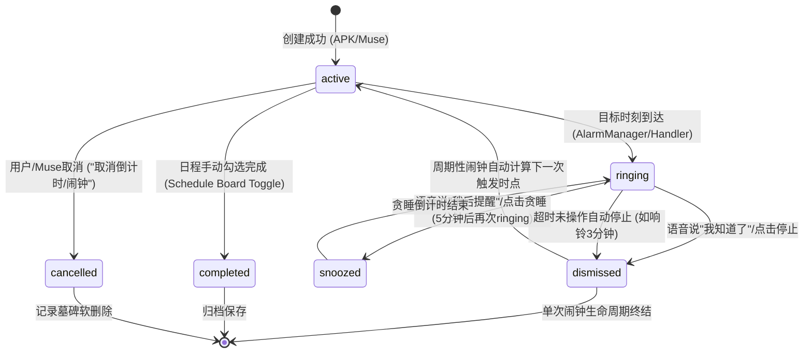
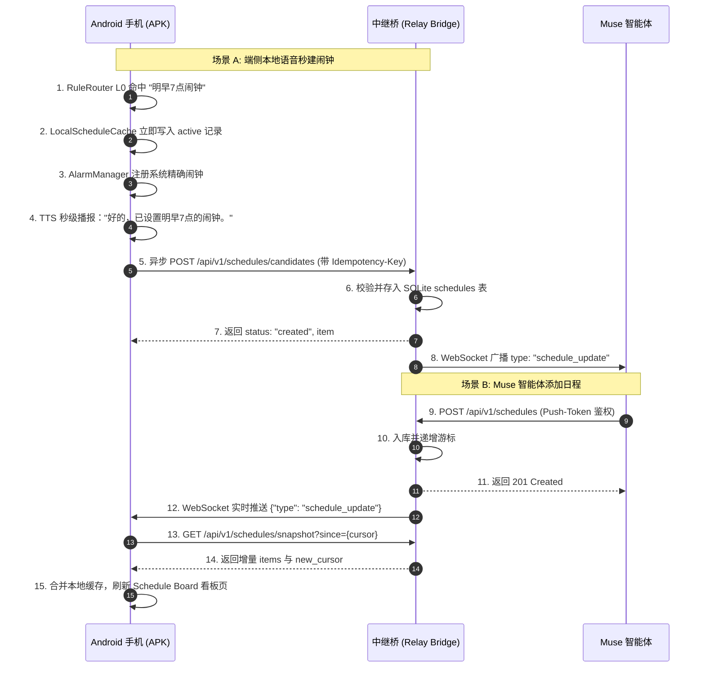
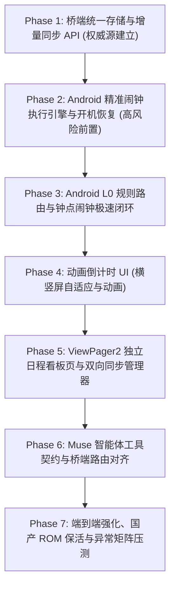

# Voice Kiosk 闹钟、倒计时与日程提醒架构设计与实施计划（双端同步方案）

> **文档状态**：已批准执行（2026-11-17，用户说“执行”；§12.2 的 4 个问题均按推荐选项：不兼容旧版、倒计时轻柔 3 声+30 秒自动停、日程仅今天+明天、最多 3 个并发倒计时）  
> **实施目标仓库**：`kqstone/voice-kiosk-relay`（本地路径：`~/workspace/voice-kiosk-relay`）及文档归档仓库 `kqstone/voice-kiosk`  
> **文档定位**：本计划严格依据 `voice-kiosk-relay` 现有实际代码与实测数据制定，**只写计划，不改动任何代码文件**。计划内所有技术结论均标注对应源文件与行号，严禁任何硬编码生产配置（所有地址、模型、密钥、端口均由环境变量注入），示例中严禁真实个人信息。

---

## 1. 目标、非目标与现状代码核实

### 1.1 核心背景与现状代码核实（Gaps Stated Plainly）

经过对 [~/workspace/voice-kiosk-relay](file:///home/hatch/workspace/voice-kiosk-relay) 现有代码的完整审查，核实以下事实与当前断点：

1. **钟点时间闹钟（Clock-Time Alarms）当前完全无可用链路**：
   - 在 Android 端 [RuleRouter.kt](file:///home/hatch/workspace/voice-kiosk-relay/android/app/src/main/java/com/voicekiosk/app/ondevice/route/RuleRouter.kt#L87-L99) 中，`timer()` 函数仅调用 `parseDuration()` 匹配相对时长（如“5分钟”、“半小时”，见 [RuleRouter.kt:377-391](file:///home/hatch/workspace/voice-kiosk-relay/android/app/src/main/java/com/voicekiosk/app/ondevice/route/RuleRouter.kt#L377-L391)）。
   - 当用户说“定一个明天早上七点的闹钟”或“设十点钟闹钟”时，`parseDuration` 返回 `null`，端侧 L0 规则直接漏掉。
   - 漏掉后经由 [TurnOrchestrator.kt](file:///home/hatch/workspace/voice-kiosk-relay/android/app/src/main/java/com/voicekiosk/app/ondevice/route/TurnOrchestrator.kt#L260-L280) 转入云端请求，发往中继桥 `/api/v1/chat`（[main.py:142-165](file:///home/hatch/workspace/voice-kiosk-relay/relay-bridge/app/main.py#L142-L165)）。
   - 中继桥虽然生成了文本回复，但桥端到手机端**没有设备动作（Device-Action）通道**，中继桥回复接口是纯文本的（`ChatResponse(reply=...)`），手机根本不会设定系统或应用内闹钟。当前手机无法通过语音设置任何钟点时间闹钟。
2. **时长倒计时（Countdown Timers）已在端侧完整工作且速度极快**：
   - 依据 [RuleRouter.kt:87-99](file:///home/hatch/workspace/voice-kiosk-relay/android/app/src/main/java/com/voicekiosk/app/ondevice/route/RuleRouter.kt#L87-L99) 和 [LocalToolExecutor.kt:243-261](file:///home/hatch/workspace/voice-kiosk-relay/android/app/src/main/java/com/voicekiosk/app/ondevice/tools/LocalToolExecutor.kt#L243-L261)，时长倒计时（如“倒计时十分钟”、“20分钟后提醒我关火”）直接在端侧 L0 秒级识别（<1ms），由 [AndroidLocalPlatform.kt:119-130](file:///home/hatch/workspace/voice-kiosk-relay/android/app/src/main/java/com/voicekiosk/app/ondevice/tools/AndroidLocalPlatform.kt#L119-L130) 在主线程通过 `Handler.postDelayed` 执行。
   - 现状缺陷：计时器完全属于内存临时任务（`timers: mutableListOf<Runnable>`），应用重启或被杀即丢失；且 UI 上仅有语音播报（[VoiceKioskService.kt:1349-1360](file:///home/hatch/workspace/voice-kiosk-relay/android/app/src/main/java/com/voicekiosk/app/VoiceKioskService.kt#L1349-L1360)），**缺乏动画倒计时界面呈现**，并且桥端完全感知不到正在进行的倒计时。
3. **日程与提醒（Schedules and Reminders）当前全部路由至 Muse，但 Muse 无法下发到手机**：
   - 依据中继桥路由提示词 [router.py:76-80](file:///home/hatch/workspace/voice-kiosk-relay/relay-bridge/app/router.py#L76-L80)，“执行外部操作与动作指令（如添加日程或提醒等）”被明确划归 `muse` 通道。
   - 桥将工单放入对话队列 [queue.py:98-124](file:///home/hatch/workspace/voice-kiosk-relay/relay-bridge/app/queue.py#L98-L124)，等待 Muse 轮询叫醒与回答。
   - 但 Muse 目前只能通过 `/api/v1/conversations/{id}/reply` 返回一串文字（如“已为您记录明天下午两点开会”），**缺乏向中继桥与手机下发可执行日程实体的通道**，手机端看板上也无处显示。
4. **成熟可复用的成熟同步体系：长期记忆（Memory Sync Pattern）**：
   - 中继桥已具备经过实测检验的成熟增量同步套件：依据 [memory_store.py:435-585](file:///home/hatch/workspace/voice-kiosk-relay/relay-bridge/app/memory_store.py#L435-L585) 与 [main.py:435-477](file:///home/hatch/workspace/voice-kiosk-relay/relay-bridge/app/main.py#L435-L477)，具备增量快照 `GET /api/v1/memory/snapshot?since={cursor}`、候选提交 `POST /api/v1/memory/candidates`、单调增游标 `{updated_at}_{id}`、墓碑表 `memory_tombstones`、30 天自动修剪（`prune_tombstones`）以及 `Idempotency-Key` 幂等防护。
   - Android 端在 [LocalMemoryCache.kt:19-75](file:///home/hatch/workspace/voice-kiosk-relay/android/app/src/main/java/com/voicekiosk/app/memory/LocalMemoryCache.kt#L19-L75) 与 [MemoryManager.kt:125-148](file:///home/hatch/workspace/voice-kiosk-relay/android/app/src/main/java/com/voicekiosk/app/memory/MemoryManager.kt#L125-L148) 中实现了本地加密持久化缓存、离线队列合并以及后台自动刷新。
5. **Android 端看板架构成熟度**：
   - 依据 [MainPagerAdapter.kt:34-140](file:///home/hatch/workspace/voice-kiosk-relay/android/app/src/main/java/com/voicekiosk/app/ui/MainPagerAdapter.kt#L34-L140) 与 [BoardRepository.kt:23-120](file:///home/hatch/workspace/voice-kiosk-relay/android/app/src/main/java/com/voicekiosk/app/data/BoardRepository.kt#L23-L120)，ViewPager2 动态承载 Page 0（主屏大时钟）与 Page 1..N（通用看板），具备 WebSocket 实时推送（`/ws`）+ 60s 降级轮询 + 双向完成态切换（`toggle`）。

### 1.2 实施目标（Goals）

1. **三项核心能力全打通**：
   - **钟点闹钟**：支持自然语言设定绝对时点闹钟（如“明早7点半叫我”、“周一到周五早上7点闹钟”），并在应用内可靠响铃、支持屏幕亮屏唤醒、悬浮弹窗、贪睡与语音关闭。
   - **倒计时器**：保留端侧 L0 秒级快速生效体验；增加沉浸式环形/线性动画倒计时界面（横屏居右、竖屏居下）；支持多倒计时切换；状态双向同步至中继桥。
   - **日程与提醒**：建立统一日程数据模型；在 ViewPager2 中增加专门的日程看板页（Schedule Board Page），时间线呈现今明日程并支持勾选归档；支持 Muse 主动创建与查询。
2. **中继桥为中枢的双向同步（Two-Way Sync Hub）**：
   - 中继桥作为权威数据中心（Single Source of Truth），上连 Muse 智能体，下连 Android APK。
   - 复用长期记忆成熟同步协议（增量快照、候选提交、单调游标、墓碑、30 天修剪、WebSocket 实时广播），支持离线操作、断网续传与并发冲突解决。
3. **保持既有优势**：
   - 保持现有相对时长倒计时的端侧即时响应（零网络延迟、秒播报）。

### 1.3 非目标（Non-Goals）

1. **不接管系统原生闹钟应用（No OEM Clock App Hijacking）**：
   - 坚决不使用系统未公开的私有 Clock Provider 或不同厂商定制的 DeskClock Intent，所有闹钟、倒计时与提醒完全在 Voice Kiosk 应用内部自闭环调度与渲染，避免各厂商 ROM（华为 EMUI/鸿蒙、小米 HyperOS、OPPO ColorOS）的系统闹钟兼容性黑洞。
2. **不替代第三方专业日历同步协议（No CalDAV / Exchange Engine）**：
   - 本系统定位为家庭智能语音屏的日程提醒与看板，不做复杂的企业级 CalDAV/Exchange 双向同步引擎，不引入多租户权限系统。
3. **不依赖网络进行响铃判定**：
   - 闹钟与倒计时到达时刻的响铃决不能依赖网络。即使中继桥离线、断网，已排期的闹钟与倒计时必须在手机端准时响铃。

---

## 2. 统一数据模型与状态机（Unified Data Model）

为了避免三种功能各自为政导致同步逻辑分裂，本设计采用**统一实体结构（ScheduleItem）**，通过 `type` 字段区分实体类别，通过 `recurrence` 区分单次与周期性。

### 2.1 统一实体模式（Shared Schema）

```json
{
  "id": "sch_9f8e7d6c5b4a",
  "type": "alarm",
  "title": "晨起闹钟",
  "target_time_utc": 1731884400.0,
  "duration_seconds": 0,
  "recurrence": "FREQ=WEEKLY;BYDAY=MO,TU,WE,TH,FR",
  "status": "active",
  "origin": "apk_voice",
  "created_at_utc": 1731800000.0,
  "updated_at_utc": 1731800000.0,
  "metadata": {
    "label": "工作日起床",
    "ringtone": "gentle_chime",
    "snooze_count": 0,
    "max_snooze": 3,
    "snooze_interval_seconds": 300,
    "completed_at_utc": null
  }
}
```

#### 字段详细规范

| 字段名 | 类型 | 说明 | 取值范围 / 示例 |
|---|---|---|---|
| `id` | `TEXT` (PK) | 全局唯一 ID，以前缀区分来源便于排查 | `sch_` + 12位十六进制字符串 |
| `type` | `TEXT` | 实体核心类型 | `alarm`（钟点闹钟）、`countdown`（倒计时器）、`schedule`（日程提醒） |
| `title` | `TEXT` | 语音播报与卡片展示标题 | 口语化文本，如“关火”、“去医院取报告”、“起床” |
| `target_time_utc` | `REAL` | 触发目标时点的 UTC 秒级 Unix 时间戳（浮点数） | 如 `1731884400.0`（对应北京时间 2026-11-18 07:00:00） |
| `duration_seconds` | `INTEGER` | 初始设定时长（秒），倒计时专用；闹钟与日程为 0 | 倒计时专用，如 `600`（10分钟） |
| `recurrence` | `TEXT` | 重复规则字符串（RFC 5545 RRULE 轻量子集） | `""`（单次）、`FREQ=DAILY`（每天）、`FREQ=WEEKLY;BYDAY=MO,TU,WE,TH,FR`（工作日）、`FREQ=WEEKLY;BYDAY=SA,SU`（周末） |
| `status` | `TEXT` | 实体生命周期状态 | `active`, `ringing`, `snoozed`, `dismissed`, `completed`, `cancelled` |
| `origin` | `TEXT` | 创建来源标识 | `apk_voice`（手机端侧语音）、`apk_ui`（手机触控）、`muse_voice`（Muse语音创建）、`muse_push`（Muse外部推入）、`bridge_rule`（中继桥快答创建） |
| `created_at_utc` | `REAL` | 创建时刻 UTC 秒级时间戳 | 浮点数，如 `1731800000.0` |
| `updated_at_utc` | `REAL` | 最后更新时刻 UTC 秒级时间戳 | 浮点数，用于增量游标与冲突判定 |
| `metadata` | `TEXT` (JSON) | 扩展元数据 JSON 字符串 | 包含铃声名称、已贪睡次数、标签、所属分类等 |

### 2.2 实体生命周期状态机（State Machine）



#### 关键状态迁移逻辑
1. **单次 vs 周期性重置**：
   - 单次闹钟或日程在处于 `dismissed` 或 `completed` 后即转入终结态；
   - 具备 `recurrence` 规则的实体，当触发 `dismissed` 时，中枢调度器自动计算下一周期的 `target_time_utc`，更新 `status = "active"` 并递增 `updated_at_utc`。
2. **终结态不可逆原则（Terminal State Protection）**：
   - 处于 `dismissed`、`completed`、`cancelled` 的实体，不能被陈旧的 `active` 状态覆盖更新。

### 2.3 时区与时间解析处理规范（Timezone Handling）

1. **统一 UTC 存储与传输**：
   - 桥端 SQLite 数据库和网络传输一律使用 UTC 秒级浮点时间戳（`target_time_utc`, `created_at_utc`, `updated_at_utc`）。
2. **端侧本地时区计算**：
   - Android 端统一使用 `ZoneId.systemDefault()` 获取本地时区（通常为 `Asia/Shanghai`），在显示和语音播报时转换为当地时间。
   - 解析“明早 7 点”时：
     $$\text{Target} = \text{LocalDate.now}(ZoneId).plusDays(1).\text{atTime}(7, 0).\text{atZone}(ZoneId).toInstant().toEpochMilli()$$
3. **时钟漂移与网络时间校准**：
   - 手机端 `AndroidLocalPlatform.nowMillis()` 获取的是本地系统时钟。桥端返回的增量数据中附带 `server_time_utc`，端侧计算时钟偏移 $\Delta t$，避免设备本地时间不准导致的同步颠簸。

---

## 3. 同步协议与协同机制（Sync Protocol）

复用 [relay-bridge/app/memory_store.py:435-585](file:///home/hatch/workspace/voice-kiosk-relay/relay-bridge/app/memory_store.py#L435-L585) 的成熟增量同步套件，并结合 WebSocket 广播形成**推拉结合的双向同步网络**。



### 3.1 权威源与同步架构（Source of Truth）

- **权威数据中心**：中继桥（Relay Bridge）的 SQLite 数据库 `schedules.db` 是绝对权威源。
- **Android 本地缓存**：作为离线副本（Offline Replica），保障无网可用、本地秒级响铃与离线排队。
- **Muse**：通过标准 REST API 读写中继桥，不直接连接手机。

### 3.2 双向同步管道（Push + Pull）

1. **下行近实时同步（Push Trigger）**：
   - 依托中继桥现有 WebSocket 广播基础设施（[main.py:109-129](file:///home/hatch/workspace/voice-kiosk-relay/relay-bridge/app/main.py#L109-L129)）。
   - 任何由 Muse、控制台或其它通道引起的实体增删改，桥端立即广播：
     ```json
     {
       "type": "schedule_update",
       "action": "upsert",
       "item_id": "sch_9f8e7d6c5b4a",
       "updated_at": 1731800050.0
     }
     ```
   - 手机端 [BoardRepository.kt](file:///home/hatch/workspace/voice-kiosk-relay/android/app/src/main/java/com/voicekiosk/app/data/BoardRepository.kt#L74-L76) 维持的 WS 客户端捕获该事件后，触发 `ScheduleSyncManager.fetchIncrementalSnapshot()`。
2. **下行保底增量拉取（Periodic Fallback Pull）**：
   - 周期性轮询：每 60 秒触发一次静默增量拉取（与看板现存 60 秒兜底轮询一致，[BoardRepository.kt:29](file:///home/hatch/workspace/voice-kiosk-relay/android/app/src/main/java/com/voicekiosk/app/data/BoardRepository.kt#L29)）。
   - 事件触发：网络由断开恢复、App 从后台恢复到前台时立即触发。
3. **上行候选提交（Upstream Candidate Flush）**：
   - 本地语音产生的闹钟/倒计时，先写入本地缓存并设置本地系统闹钟，随后将记录放入本地候选队列（`STATE_PENDING_UPLOAD`），由后台守护线程调用 `POST /api/v1/schedules/candidates`。

### 3.3 增量游标与墓碑机制（Cursors & Tombstones）

完全继承 [memory_store.py:504-582](file:///home/hatch/workspace/voice-kiosk-relay/relay-bridge/app/memory_store.py#L504-L582) 的单调递增游标模型：
- **游标格式**：`"{updated_at_utc}_{id}"`（如 `1731800050.0_sch_9f8e7d6c5b4a`）。
- **SQL 比较条件**：
  ```sql
  WHERE (updated_at > :cursor_ts) OR (updated_at = :cursor_ts AND id > :cursor_id)
  ORDER BY updated_at ASC, id ASC
  ```
- **删除与墓碑**：
  - 物理删除或取消时，在中继桥将 ID 存入 `schedule_tombstones` 表（记录 `id` 和 `deleted_at`）；
  - `GET /api/v1/schedules/snapshot` 同时返回增量更新的 `items` 和自游标之后产生的 `deleted_ids`；
  - 手机端收到 `deleted_ids` 后，从本地缓存物理移除对应项目并取消本地 `AlarmManager`。
- **30 天超期修剪（30-Day Pruning）**：
  - 超过 30 天的墓碑由定时任务自动物理清除；
  - 若客户端携带的游标已超过 30 天，桥端返回 `{"reset": true, "items": [...全量...], "cursor": "..."}`，客户端触发本地全量重置重建。

### 3.4 冲突仲裁与双端并发（Conflict Resolution）

1. **最后写入优先（Last-Write-Wins based on Monotonic Timestamp）**：
   - 比较 `(updated_at_utc, origin_priority)`。
2. **终结态保护规则（Terminal State Domination）**：
   - 若本地或服务端实体已迁移至终结态（`dismissed`, `cancelled`, `completed`），任何来自迟缓网络的 `active` 状态写入一律丢弃，绝不允许已关掉的闹钟被同步覆盖为“再次响铃”。
3. **并发编辑案例（Same Item Changed Concurrently）**：
   - *案例*：手机端本地触发响铃并被用户语音 Dismiss（标记 `dismissed`），而此时 Muse 刚修改了该闹钟的备注标题 `title`。
   - *仲裁*：服务端合并两者的最新有效字段：状态采纳终结态 `dismissed`，标题采纳 Muse 的最新文本更新，`updated_at_utc` 赋予当前时间戳并广播，保持双方状态最终一致。

---

## 4. 中继桥接口详细设计（Bridge API Design）

所有接口挂载在 `/api/v1/schedules` 路径下，权限设计严格遵循 `app/auth.py` 现有规范。所有配置通过环境变量注入，无硬编码。

### 4.1 认证与鉴权矩阵

- `verify_device_token`：对应 `Authorization: Bearer <DEVICE_TOKEN>`（用于 Android APK）。
- `verify_push_token`：对应 `Authorization: Bearer <PUSH_TOKEN>`（用于 Muse 智能体或外部脚本推送）。
- `verify_device_or_push_token`：两者皆可。

### 4.2 接口定义列表

#### 1. 增量快照接口（Snapshot）
- **路径**：`GET /api/v1/schedules/snapshot`
- **鉴权**：`verify_device_or_push_token`
- **查询参数**：
  - `since` (string, 可选): 游标字符串 `"{timestamp}_{id}"`。为空表示拉取全量。
  - `type` (string, 可选): 过滤 `alarm` / `countdown` / `schedule`。
- **响应结构（200 OK）**：
  ```json
  {
    "items": [
      {
        "id": "sch_1a2b3c4d5e6f",
        "type": "alarm",
        "title": "晨起闹钟",
        "target_time_utc": 1731884400.0,
        "duration_seconds": 0,
        "recurrence": "FREQ=WEEKLY;BYDAY=MO,TU,WE,TH,FR",
        "status": "active",
        "origin": "apk_voice",
        "created_at_utc": 1731800000.0,
        "updated_at_utc": 1731800000.0,
        "metadata": { "label": "工作日起床" }
      }
    ],
    "deleted_ids": ["sch_old11223344"],
    "cursor": "1731800000.0_sch_1a2b3c4d5e6f",
    "reset": false,
    "server_time_utc": 1731800010.5
  }
  ```

#### 2. 批量候选提交接口（Candidates - 专为 APK 端上行设计）
- **路径**：`POST /api/v1/schedules/candidates`
- **鉴权**：`verify_device_token`
- **Header**：`Idempotency-Key: <UUID>`（支持幂等防重放）
- **请求 Payload**：
  ```json
  {
    "candidates": [
      {
        "id": "sch_1a2b3c4d5e6f",
        "type": "countdown",
        "title": "煮鸡蛋",
        "target_time_utc": 1731800600.0,
        "duration_seconds": 600,
        "recurrence": "",
        "status": "active",
        "origin": "apk_voice",
        "created_at_utc": 1731800000.0,
        "updated_at_utc": 1731800000.0,
        "metadata": {}
      }
    ]
  }
  ```
- **响应结构（200 OK）**：
  ```json
  {
    "results": [
      {
        "id": "sch_1a2b3c4d5e6f",
        "status": "created",
        "item": { "...完整数据..." }
      }
    ],
    "changed": true
  }
  ```

#### 3. 单项 CRUD 与动作接口（专为 Muse 及后台控制台设计）
- **创建项目**：`POST /api/v1/schedules`
  - 鉴权：`verify_device_or_push_token`
  - Payload：包含 `type`, `title`, `target_time_utc`, `duration_seconds`, `recurrence`, `metadata`
  - 返回：`201 Created`，返回创建好的完整 `ScheduleItem` 对象。
- **列表查询**：`GET /api/v1/schedules`
  - 参数：`type`, `status`, `from_utc`, `to_utc`, `limit=50`, `offset=0`
  - 返回：`ScheduleItem` 数组。
- **单项查询**：`GET /api/v1/schedules/{id}`
- **全量/部分更新**：`PUT /api/v1/schedules/{id}`
  - 更新字段并自动将 `updated_at_utc` 设为当前时间，触发 WebSocket 广播。
- **删除项目**：`DELETE /api/v1/schedules/{id}`
  - 物理删除 `schedules` 记录，插入 `schedule_tombstones` 墓碑，广播删除事件。
- **动作触发快捷接口**：`POST /api/v1/schedules/{id}/action`
  - Payload: `{"action": "dismiss" | "snooze" | "complete" | "cancel", "snooze_seconds": 300}`
  - 便于 Muse 或 UI 直接驱动状态流转。

---

## 5. Android 客户端深度架构设计（Android Design）

### 5.1 钟点闹钟执行引擎（Alarm Execution Engine）

针对闹钟“必须按时响铃、即使锁屏断网也能唤醒”的严苛要求，设计专门的本地告警引擎：

```
                    [ScheduleSyncManager]
                             │ 本地持久化 (SQLite/Cache)
                             ▼
                    [AlarmScheduler]
                             │ Intent + PendingIntent
                             ▼
                    [AlarmManager] (系统精确调度)
                             │ setExactAndAllowWhileIdle()
                             ▼
               [AlarmBroadcastReceiver] (唤醒广播)
                             │
       ┌─────────────────────┴─────────────────────┐
       ▼                                           ▼
[WakeLock 获取 & 亮屏]                      [AlarmRingingService]
Window.addFlags(SHOW_WHEN_LOCKED)          AudioManager.STREAM_ALARM
WakeLock(PARTIAL_WAKE_LOCK, 3min)          MediaPlayer 循环播放本地铃声
       │                                           │
       └─────────────────────┬─────────────────────┘
                             ▼
                   [AlarmAlertActivity]
           (全屏/悬浮极简黑底告警界面，大字体)
           - 显示标题与时间
           - 按钮："关闭" (Dismiss) / "稍后" (Snooze)
           - 语音指令即时监听："我知道了" / "别响了"
```

1. **精准调度机制（Exact Alarms）**：
   - 使用 Android `AlarmManager.setExactAndAllowWhileIdle(AlarmManager.RTC_WAKEUP, triggerAtMillis, pendingIntent)`。
   - `PendingIntent` 携带 `schedule_id` 与防重校验码，目标定向指向应用内未导出的 `AlarmBroadcastReceiver`。
2. **锁屏穿透与亮屏（Screen Wakeup）**：
   - 依据现有 [MainActivity.kt:50-52](file:///home/hatch/workspace/voice-kiosk-relay/android/app/src/main/java/com/voicekiosk/app/MainActivity.kt#L50-L52) 的配置模式，告警界面设置：
     ```kotlin
     setShowWhenLocked(true)
     setTurnScreenOn(true)
     window.addFlags(WindowManager.LayoutParams.FLAG_KEEP_SCREEN_ON)
     ```
   - 获取 `PowerManager.PARTIAL_WAKE_LOCK` 并在最长响铃超时（如 3 分钟）后强制释放，杜绝唤醒锁泄露引发电池耗尽。
3. **音频播放通道（Audio Stream）**：
   - 使用 `AudioManager.STREAM_ALARM` 流播放内置离线无损铃声（即使系统媒体音量处于静音或低音量，闹钟流依然按设定响度响铃）。
4. **语音与触控双重交互解脱**：
   - 告警界面弹出时，自动启动语音捕获并降低铃声音量（Audio Ducking）；
   - 用户说出“知道了”、“别响了”、“关闭闹钟”、“停止”立即触发 Dismiss 并停止铃声；
   - 用户说出“再睡五分钟”、“稍后提醒”触发 Snooze。

### 5.2 倒计时动画 UI 与双屏幕朝向适配（Countdown Animation UI）

根据用户需求：“倒计时是一个动画倒计时展示，**横屏在右侧，竖屏在下方**”。

#### 1. 竖屏布局（Portrait Layout - fragment_home.xml）
- 依据现有 [fragment_home.xml:17-100](file:///home/hatch/workspace/voice-kiosk-relay/android/app/src/main/res/layout/fragment_home.xml#L17-L100)：
  - 顶部是 `tvDateLine` 与巨幅时钟 `textClock`（76sp）；
  - 中间是天气胶囊 `weatherCapsule`；
  - **倒计时展示区放置在天气胶囊下方、Now-Playing 组件上方**（居中垂直排布）；
  - 平时无倒计时时组件收起（`GONE`），一旦倒计时启动以平滑淡入展开；
  - 呈现设计：OLED 黑色背景上的细线发光进度圆环，环心显示剩余分秒（如 `08:45`），圆环随秒数流逝平滑缩减，底部附带取消按钮与标签说明。

#### 2. 横屏布局（Landscape Layout - layout-land/fragment_home.xml）
- 依据现有 [layout-land/fragment_home.xml:17-114](file:///home/hatch/workspace/voice-kiosk-relay/android/app/src/main/res/layout-land/fragment_home.xml#L17-L114)：
  - 采用水平双栏结构：左栏 `layoutHomeLeft` 为日期、巨幅时钟（96sp）与天气胶囊；
  - **右侧区域作为多功能仪表盘：右侧优先渲染动画倒计时卡片**（固定宽度 360dp，与现有 `layoutNowPlaying` 共享右侧区域）；
  - 当无音乐播放且有倒计时运行时，倒计时卡片占据右侧；当两者共存时，采用卡片上下分叠或平滑轮播。

#### 3. 动画与性能保障
- 使用自定义 View `CountdownArcView`：使用硬件加速的 `Canvas.drawArc` 与 `ValueAnimator`，避免频繁的布局测量（RequestLayout）；
- 严格遵循 OLED 纯黑省电配色（`#000000` 底色，`#F59E0B` 琥珀色微光进度条与 `#FFFFFF` 数字），防止烧屏与发热。

### 5.3 日程提醒独立看板页（Schedule Board Page）

根据用户需求：“日程提醒获得一个单独的看板页”。

1. **ViewPager2 页面集成**：
   - 依据 [MainPagerAdapter.kt:42-45](file:///home/hatch/workspace/voice-kiosk-relay/android/app/src/main/java/com/voicekiosk/app/ui/MainPagerAdapter.kt#L42-L45)，在 `MainPagerAdapter` 中新增独立视图类型：
     ```kotlin
     const val VIEW_TYPE_HOME = 0
     const val VIEW_TYPE_SCHEDULE = 1   // 独立日程看板页
     const val VIEW_TYPE_BOARD = 2      // 其它远端看板页
     ```
   - 页面固定为 ViewPager2 的第 1 页（滑动一次即达），PageIndicator 自动适配对应点位。
2. **日程看板界面布局设计（fragment_schedule_board.xml）**：
   - **头部区域**：主标题“今日日程与提醒”，附带日期与待办进度标签（如“3 项待办 · 1 项已完成”）；
   - **时间线列表（Timeline RecyclerView）**：
     - 按触发时点升序排列；
     - 每张卡片呈现：时间标记（如 `14:30`）、分类色标、日程内容（如“陪孩子去图书馆”）、状态指示器；
     - 卡片右侧配备快速勾选按钮，点击后触发 `toggle`，卡片文字呈现优雅划线变灰动画；
     - 勾选状态立即更新本地缓存，并通过 `POST /api/v1/schedules/{id}/action` 异步同步到中继桥。
3. **空状态（Empty State）**：
   - 当今明两日无日程时，呈现极简低饱和度的“暂无安排，尽享悠闲时光”插画与文案，绝不显示刺眼的报错或空白。

### 5.4 客户端持久化与同步管理器（ScheduleSyncManager）

仿照 [LocalMemoryCache.kt](file:///home/hatch/workspace/voice-kiosk-relay/android/app/src/main/java/com/voicekiosk/app/memory/LocalMemoryCache.kt) 与 [MemoryManager.kt](file:///home/hatch/workspace/voice-kiosk-relay/android/app/src/main/java/com/voicekiosk/app/memory/MemoryManager.kt) 架构：
1. **LocalScheduleCache**：
   - 本地加密 JSON/SQLite 存储，维护 `snapshot` 列表、增量 `cursor` 以及待上报队列 `upload_queue`；
   - 保证应用冷启动时零毫秒从本地磁盘拉起日程与正在计时的倒计时。
2. **ScheduleSyncManager**：
   - 维护单线程后台执行器 `ExecutorService`，负责 snapshot 拉取与 candidate 上报；
   - 接收 `BridgeWebSocketClient` 的消息总线事件；
   - 提供 `addAlarmLocally(...)`, `cancelTimerLocally(...)`, `toggleScheduleLocally(...)` 供本地工具直接调用。

### 5.5 后台保活与开机重启恢复（Background & Reboot Resilience）

1. **开机自启完整恢复（BootReceiver.kt 扩展）**：
   - 审查现有 [BootReceiver.kt:18-45](file:///home/hatch/workspace/voice-kiosk-relay/android/app/src/main/java/com/voicekiosk/app/BootReceiver.kt#L18-L45)，目前已在接收 `ACTION_BOOT_COMPLETED` 时启动 `VoiceKioskService` 与 `MainActivity`；
   - 扩展 `BootReceiver`：在服务启动后，立即调用 `ScheduleSyncManager.rescheduleAllActiveAlarms()`，遍历本地缓存中所有 `status == "active"` 且 `target_time_utc > now` 的闹钟与提醒，逐一向系统 `AlarmManager` 重新注册 `PendingIntent`，保证手机重启后一个闹钟都不会丢。
2. **后台运行保活**：
   - 闹钟使用的是系统内核层支持的 RTC_WAKEUP 机制，系统会在目标时刻精确唤醒 CPU，**即便应用已被杀或处于 Doze 深度休眠模式，内核级 AlarmManager 仍会拉起 BroadcastReceiver**。

---

## 6. Muse 智能体交互接口（Muse Interface）

Muse 作为高级智能体，负责综合长短期记忆、对话上下文以及外部日历进行复杂日程规划。

### 6.1 工具调用规范（Function Calling / Tools Schema）

在中继桥或 Muse 接入层为 Muse 注册以下 4 个标准工具契约：

```json
[
  {
    "type": "function",
    "function": {
      "name": "create_schedule_item",
      "description": "在中继桥和家庭语音屏上创建新的闹钟、倒计时或日程提醒",
      "parameters": {
        "type": "object",
        "properties": {
          "type": {
            "type": "string",
            "enum": ["alarm", "countdown", "schedule"],
            "description": "实体类别：alarm(钟点闹钟), countdown(倒计时器), schedule(日程提醒)"
          },
          "title": {
            "type": "string",
            "description": "事项标题或标签，例如：去机场接人、烤箱烤蛋糕"
          },
          "target_time_utc": {
            "type": "number",
            "description": "触发时刻的秒级 UTC 时间戳 (若为倒计时可不填，由 duration_seconds 推算)"
          },
          "duration_seconds": {
            "type": "integer",
            "description": "时长秒数，倒计时专用 (例如 600 代表10分钟)"
          },
          "recurrence": {
            "type": "string",
            "description": "重复规则 (RFC 5545 RRULE)，单次则留空。常用值：FREQ=DAILY, FREQ=WEEKLY;BYDAY=MO,TU,WE,TH,FR"
          }
        },
        "required": ["type", "title"]
      }
    }
  },
  {
    "type": "function",
    "function": {
      "name": "list_schedule_items",
      "description": "查询家庭语音屏上的日程、闹钟与倒计时",
      "parameters": {
        "type": "object",
        "properties": {
          "type": { "type": "string", "enum": ["alarm", "countdown", "schedule"] },
          "status": { "type": "string", "enum": ["active", "all"] },
          "from_utc": { "type": "number" },
          "to_utc": { "type": "number" }
        }
      }
    }
  },
  {
    "type": "function",
    "function": {
      "name": "update_schedule_item",
      "description": "修改现有日程事项的标题、时间或状态",
      "parameters": {
        "type": "object",
        "properties": {
          "id": { "type": "string", "description": "事项 ID" },
          "title": { "type": "string" },
          "target_time_utc": { "type": "number" },
          "status": { "type": "string", "enum": ["active", "dismissed", "cancelled", "completed"] }
        },
        "required": ["id"]
      }
    }
  },
  {
    "type": "function",
    "function": {
      "name": "delete_schedule_item",
      "description": "删除或取消某项闹钟、倒计时或日程",
      "parameters": {
        "type": "object",
        "properties": {
          "id": { "type": "string", "description": "事项 ID" }
        },
        "required": ["id"]
      }
    }
  }
]
```

### 6.2 异常与无法执行时的交互话术设计（Error Handling & Grounding）

当 Muse 收到无法执行的请求时，必须给出清晰明确的口语化反馈，禁止输出系统内部报错码：

| 异常场景 | 内部原因 | Muse 对用户的口语化回答示例 |
|---|---|---|
| **过去的时间** | 计算出的目标时点早于当前时间 | “你说的这个时间好像已经过去了，要帮您设置在明天同一时间吗？” |
| **模糊的时点** | 用户说“过两天提醒我”，缺乏具体时点 | “好的，请问是周三还是周四？具体几点提醒您比较合适？” |
| **中继桥不可达** | Muse 调用桥 API 出现网络超时 | “抱歉，我暂时连不上家里的小屏幕，请稍等片刻再试，或者您可以直接对屏幕说‘设闹钟’。” |
| **相互冲突的重复** | 既说“每天”又指定特定单次日期 | “您是希望只设置一次，还是每周一都提醒呢？” |

---

## 7. 路由演进与分层调度变更（Router Changes）

现有对话三层路由体系：Android 端 L0 规则路由 → 桥端内置快答路由 → Muse 深度通道。需做精细化扩充。

### 7.1 Android 端 L0 规则路由扩充（RuleRouter.kt）

在 [RuleRouter.kt:87-99](file:///home/hatch/workspace/voice-kiosk-relay/android/app/src/main/java/com/voicekiosk/app/ondevice/route/RuleRouter.kt#L87-L99) 中增加专门的钟点时间闹钟匹配，保持原有时长倒计时逻辑不变。

```kotlin
// 现有倒计时逻辑保持不变 (保留原有极速体验):
private fun timer(s: String): RouteDecision? {
    if (TIMER_CANCEL.matches(s)) return local(Intents.TIMER, "action" to "cancel")
    // ... 原有 duration 解析 ...
}

// 新增钟点时间闹钟匹配 (本地秒回):
private fun alarmClock(s: String): RouteDecision? {
    if (ALARM_CANCEL.matches(s)) return local(Intents.ALARM, "action" to "cancel")
    val m = ALARM_SET_REGEX.matchEntire(s) ?: return null
    val dayOffset = parseDayOffset(m.groups["day"]?.value) ?: 0
    val time = ChineseTimeParser.parse(m.groups["time"]!!.value) ?: return null
    return local(
        Intents.ALARM,
        "action" to "set",
        "day_offset" to dayOffset.toString(),
        "hour" to time.hour.toString(),
        "minute" to time.minute.toString(),
        "recurrence" to (m.groups["repeat"]?.value ?: "")
    )
}
```

#### 意图分流对照表

| 表达样例 | 匹配层级 | 路由通道 | 执行载体 | 延迟 |
|---|---|---|---|---|
| “倒计时十分钟” / “5分钟后提醒我关火” | Android L0 | `LOCAL` (`Intents.TIMER`) | `LocalToolExecutor` 启动倒计时 + UI 展示 | **< 1ms** |
| “明早7点叫我” / “设一个下午3点的闹钟” | Android L0 | `LOCAL` (`Intents.ALARM`) | `LocalToolExecutor` 本地排期 + 异步推桥 | **< 20ms** |
| “工作日早上7点半定个闹钟” | Android L0 | `LOCAL` (`Intents.ALARM`) | 本地排期周期闹钟 + 异步推桥 | **< 20ms** |
| “今天有什么日程安排” / “看看明天的提醒” | 桥端快答 | `LOCAL` (Bridge LLM) | 桥端直接查询 `schedules.db` 并组织播报 | **~1-2s** |
| “下周二下午和王总开会，提前一小时提醒我带合同并总结汇报要点” | 桥端路由 | `MUSE` (Full Agent) | 进工单队列由 Muse 深度规划与调用工具 | **~5-10s** |

### 7.2 桥端路由提示词调整（relay-bridge/app/router.py）

修改 [relay-bridge/app/router.py:62-91](file:///home/hatch/workspace/voice-kiosk-relay/relay-bridge/app/router.py#L62-L91) 中的 `ROUTER_SYSTEM_PROMPT`：

```python
# 明确本地与 Muse 通道边界：
"1. 路由至 local（由中继桥内置模型快答处理，优先快速响应）：\n"
"   - 简单问答、常识问答、天气与时间查询、日常闲聊\n"
"   - 看板与日程数据查询（如查询今日日程、当前闹钟与待办等，中继桥已直连日程数据库，切勿路由至 muse）\n"
"   - 简单的日程与闹钟单步操作（如直接设定明确时间的日程，可由桥端快速落库）\n"
"2. 路由至 muse（由高级智能体 Muse 深度处理，需要完整智能体能力）：\n"
"   - 包含多步骤、上下文推理或外部多工具综合调用的复杂日程任务（例如：分析邮件/聊天记录后排期、结合历史记忆规划全天行程等）\n"
```

---

## 8. 分阶段实施路径（Phases & Acceptance Criteria）

严格遵循“**高风险集成前置**”原则：先打通桥端权威存储与同步协议，再攻坚 Android 底层精准闹钟与开机唤醒，随后搭建 UI 呈现与路由，最后对接 Muse 智能体与端到端强化。



### Phase 1：中继桥统一数据模型与增量同步 API（Riskiest Foundation First）
- **核心任务**：
  1. 在 `relay-bridge/app/` 下新建 `schedule_store.py`，实现 SQLite 数据表 `schedules` 与 `schedule_tombstones`，开启 WAL 模式；
  2. 实现 `get_snapshot(since)`、`submit_candidates()`、单调游标计算与 30 天墓碑修剪；
  3. 在 `main.py` 挂载 `/api/v1/schedules/snapshot`、`/api/v1/schedules/candidates` 及 CRUD 接口；
  4. 实体变更时调用 `manager.broadcast({"type": "schedule_update", ...})`。
- **验收标准（Acceptance Criteria）**：
  - `pytest relay-bridge/tests/test_schedule_store.py` 100% 通过（涵盖游标单调性、全量重置、墓碑修剪）；
  - `pytest relay-bridge/tests/test_schedule_api.py` 100% 通过（鉴权、候选防重、增量拉取验证）。

### Phase 2：Android 精准闹钟执行引擎与开机恢复（Device Integration Core）
- **核心任务**：
  1. 声明 `SCHEDULE_EXACT_ALARM` / `USE_EXACT_ALARM` 与 `WAKE_LOCK` 权限；
  2. 编写 `AlarmScheduler`，封装 `AlarmManager.setExactAndAllowWhileIdle()`；
  3. 实现 `AlarmBroadcastReceiver` 与 `AlarmRingingService`，使用 `STREAM_ALARM` 播放内置音频；
  4. 实现 `AlarmAlertActivity`，设置 `showWhenLocked` 与 `turnScreenOn`，支持点击与语音关闭；
  5. 扩展 `BootReceiver.kt`，实现设备重启自动恢复有效闹钟。
- **验收标准（Acceptance Criteria）**：
  - 熄屏及进入 Doze 模式下，设定的闹钟能准时在 1 秒误差内点亮屏幕并大声响铃；
  - 手机重启后通过 `adb shell dumpsys alarm` 验证已注册闹钟完整恢复；
  - 语音说“我知道了”可在 500ms 内停止响铃。

### Phase 3：Android L0 规则路由与钟点闹钟极速闭环（Local Fast Path）
- **核心任务**：
  1. 编写 `ChineseTimeParser.kt`，支持“明早七点半”、“下午两点一刻”、“每天早上8点”等中文时点解析；
  2. 扩展 `RuleRouter.kt`，新增 `alarmClock()` 规则，输出 `Intents.ALARM` 意图；
  3. 在 `LocalToolExecutor.kt` 中实现 `alarm(d: RouteDecision)`，调度本地排期并生成语音回话。
- **验收标准（Acceptance Criteria）**：
  - `RuleRouterTest` 新增 50+ 组真实中文时点用例，全通过且执行时间 < 2ms；
  - 离线断网状态下对手机说“明早7点闹钟”，能立刻听到“好的，已设置明天早上7点闹钟”并成功注册本地告警。

### Phase 4：动画倒计时 UI（横竖屏自适应与动画）
- **核心任务**：
  1. 编写自定义发光环形倒计时组件 `CountdownArcView.kt`；
  2. 在 `fragment_home.xml`（竖屏）与 `layout-land/fragment_home.xml`（横屏）集成倒计时容器；
  3. 改造 `AndroidLocalPlatform.startTimer`，将状态通知到 UI 控制器触发平滑展开动画。
- **验收标准（Acceptance Criteria）**：
  - 语音开启倒计时后，竖屏模式下天气胶囊下方立即呈现动画圆环并平滑倒计时；
  - 旋转至横屏模式，动画圆环位于屏幕右半区，数字字体清晰无形变，UI 无跳变。

### Phase 5：ViewPager2 独立日程看板页与双向同步管理器（Schedule Board Page & Sync）
- **核心任务**：
  1. 实现 `LocalScheduleCache.kt` 与 `ScheduleSyncManager.kt`；
  2. 在 `MainPagerAdapter.kt` 中新增独立 `VIEW_TYPE_SCHEDULE` 页面；
  3. 实现日程卡片勾选完成动画与状态回写同步；
  4. 订阅 WebSocket `schedule_update` 广播，实现秒级自动刷新。
- **验收标准（Acceptance Criteria）**：
  - 滑动至日程看板页可浏览近两日日程卡片；
  - 在控制台或外部向桥端推入一条新日程，手机在 1 秒内通过 WebSocket 自动刷出新卡片无需刷新；
  - 点击卡片勾选框，卡片显示完成划线，中继桥对应记录状态变为 `completed`。

### Phase 6：Muse 智能体工具契约与桥端路由对齐（Muse Integration）
- **核心任务**：
  1. 在 `router.py` 更新系统路由提示词与关键词映射；
  2. 为 Muse 配备标准 Tool Definitions（CRUD）；
  3. 优化对话队列超时机制（针对日程任务提供清晰的先导提示词）。
- **验收标准（Acceptance Criteria）**：
  - Muse 能够通过 Function Calling 成功调用中继桥接口添加多步骤日程，并实时显示在手机看板上；
  - 面对“昨天下午三点叫我”的无效输入，Muse 正确进行口语化澄清而非崩溃。

### Phase 7：端到端强化、国产 ROM 保活与异常矩阵压测（Hardening）
- **核心任务**：
  1. 针对国产定制 ROM（华为/荣耀、小米、OPPO）进行深度防杀加固与自启指南说明；
  2. 模拟断网 24 小时、弱网丢包、并发冲突等多重边缘用例；
  3. 运行自动化集成测试套件。
- **验收标准（Acceptance Criteria）**：
  - 断网状态下进行新增、删除与完成操作，恢复网络后数据完整合并且无重复；
  - 连续运行 48 小时内存占用稳定，无 WakeLock 泄露。

---

## 9. 测试与验证矩阵（Testing & Verification Matrix）

| 验证维度 | 测试对象 | 测试方法与工具 | 判定标准 |
|---|---|---|---|
| **单元测试 (Bridge)** | `ScheduleStore` 增量游标与墓碑 | `pytest relay-bridge/tests/test_schedule_store.py` | 100% 覆盖单调性、全量重置、30天修剪逻辑 |
| **单元测试 (Bridge)** | Schedules REST API | `pytest relay-bridge/tests/test_schedule_api.py` | 鉴权失败拒绝、正常 CRUD、幂等防重放正确 |
| **单元测试 (Android)**| `ChineseTimeParser` | JUnit 4 / Robolectric 测试 100+ 常见口语时点 | 覆盖各方言习惯及“点/分/一刻/半”，零崩溃 |
| **单元测试 (Android)**| `RuleRouter` 闹钟分流 | `RuleRouterTest.kt` | 钟点闹钟精准进 LOCAL，复杂任务正确进 CLOUD |
| **集成测试 (Sync)** | WebSocket 实时推送与增量同步 | Python 模拟客户端 + 本地 WebSocket 广播断言 | Push 后 500ms 内触发 snapshot 拉取并成功合并 |
| **真机测试 (Alarm)** | 深度 Doze 锁屏精确响铃 | `adb shell dumpsys deviceidle force-idle`，锁屏等待 | 到达设定秒数，手机点亮、界面唤醒、音频大声播放 |
| **真机测试 (Reboot)**| 开机恢复 | 设定 1 小时后闹钟，执行 `adb reboot` | 重启开机完成，`dumpsys alarm` 确认闹钟依旧就绪 |
| **真机测试 (UI)** | 倒计时动画横竖屏切换 | 真机旋转屏幕，观察 `CountdownArcView` | 竖屏居下、横屏居右，动画帧率 $\ge$ 58 FPS，无内存泄露 |
| **真机测试 (Offline)**| 离线本地闭环 | 拔掉路由器网线，语音操作闹钟与倒计时 | 语音即时确认，闹钟照常响铃，无网络错误报错阻断 |

---

## 10. 风险与缓解对策（Risks & Mitigations）

### 10.1 精确闹钟权限与系统 Doze 深度休眠（Exact Alarms & Doze）
- **风险**：Android 12（API 31）引入了严格的 `SCHEDULE_EXACT_ALARM` 限制，Android 13（API 33）引入 `USE_EXACT_ALARM`；若无授权，调用 `setExactAndAllowWhileIdle` 会直接抛出 `SecurityException`。
- **缓解**：
  - 在 `AndroidManifest.xml` 中同时声明 `SCHEDULE_EXACT_ALARM` 与 `USE_EXACT_ALARM`；
  - 运行时调用 `alarmManager.canScheduleExactAlarms()` 检测；若未授权，弹出醒目的系统设置跳转指引；
  - 在设置页提供“忽略电池优化”一键跳转引导（`REQUEST_IGNORE_BATTERY_OPTIMIZATIONS`）。

### 10.2 国产定制 ROM 后台进程冻结与清理（Chinese ROMs Background Restrictions）
- **风险**：鸿蒙（HarmonyOS/EMUI）、小米（HyperOS/MIUI）等系统对后台进程采用严苛的“纯净模式”与智能省电，锁屏后极易将后台 Service 或应用连根拔起。
- **缓解**：
  - **前台服务（Foreground Service）常驻**：现存 `VoiceKioskService` 已配置常驻通知栏（`FOREGROUND_SERVICE_MICROPHONE`），保障进程最高优先级；
  - **RTC_WAKEUP 机制脱离应用存活**：`AlarmManager.RTC_WAKEUP` 是 Linux 内核 RTC 硬件层触发，广播发出时系统会临时拉起进程，配合 WakeLock 保证代码执行；
  - **在文档中附带《用户真机设置清单》**：清晰指导用户开启“应用自启动”、“允许后台活动”、“电池无限制”。

### 10.3 中文自然语言时点解析陷阱（Chinese Time Expression Nuances）
- **风险**：中文时间表达歧义极大，如“明天上午8点半”、“下周三早上”、“大后天一早”、“再过两个小时的闹钟”。
- **缓解**：
  - 建立标准分词与归一化规则：先提取日期偏移（“今天/明天/后天/周几”），再提取时段（“凌晨/早晨/上午/中午/下午/晚上”），最后提取数字基数；
  - 针对带有相对时长的闹钟（如“两小时后的闹钟”），自动转换换算为绝对时点；
  - 超出 L0 确定性规则范围的复杂模糊表达，主动放行交由桥端 LLM 或 Muse 语义澄清。

### 10.4 重复规则与节假日调休（Recurring Rules & Complex Holidays）
- **风险**：中国法定“工作日”包含周末调休补班，单纯的“周一到周五”不等于法定工作日。
- **缓解**：
  - 第一阶段仅支持确定性的周期规则：`每天`、`周一至周五(工作日)`、`周末`、`每周特定星期X`；
  - 不在端侧做复杂的法定节假日补班日历计算；若用户需要“法定节假日不响”，交由 Muse 结合在线日历服务统一编排并动态下发。

### 10.5 2 分钟 Muse 对话队列超时（2-Minute Muse Queue Timeout）
- **风险**：审查 [queue.py:172-176](file:///home/hatch/workspace/voice-kiosk-relay/relay-bridge/app/queue.py#L172-L176)，工单入队若 120 秒未被 Muse 认领处理，会自动置为 `timed_out` 并返回“Muse 现在没回，稍后再试”。
- **缓解**：
  - 明确指令（如“提醒我明天开会”）全部走桥端本地快答快速落库，不需要 Muse 排队，从根源上避开 120 秒队列超时；
  - 只有涉及跨外部系统的复杂规划才进 Muse 队列；同时在入队时先返回友好口语提示：“好的，这个日程我让 Muse 梳理一下，稍后同步到屏幕上。”

---

## 11. 部署与用户操作指引（Rollout & Deployment）

### 11.1 部署先后顺序依赖（Rollout Order）

**必须遵循“中继桥先行，APK 后行”的原则**：
1. **第一步：部署中继桥（Relay Bridge）新版本**：
   - 数据库自动迁移：中继桥启动时检测并创建 `schedules` 与 `schedule_tombstones` 数据表，对外暴露 `/api/v1/schedules` 接口，广播 WebSocket 新事件；
   - 此时旧版本 APK 依旧可以正常使用现有看板与记忆功能，不受任何影响。
2. **第二步：发布并安装新版 Android APK**：
   - 新版 APK 启动后自动连接新接口，开始执行增量同步；
   - 本地规则路由生效，用户即刻体验本地钟点闹钟与动画倒计时。

### 11.2 环境变量要求（Zero Hardcoding Rule）

严格遵循硬规则：代码中不包含任何硬编码 URL、IP、密钥或模型名，全部由环境变量提供：
- `DEVICE_TOKEN`：桥端与设备端双向校验通信令牌。
- `PUSH_TOKEN`：Muse 推送数据与调用接口令牌。
- `SCHEDULE_DB_PATH`：中继桥日程 SQLite 数据库路径（默认由 `DATA_DIR` 衍生）。
- `LLM_BASE_URL` / `LLM_MODEL_NAME`：桥端快答调用配置。

### 11.3 手机端用户手动配置清单（User Phone Setup Checklist）

APK 更新安装后，用户在 Android 手机上需完成以下单次设置：
1. **精确闹钟权限确认**：
   - 进入手机“设置” -> “应用与权限” -> “Voice Kiosk” -> “闹钟与提醒”，确认为“已允许”（Android 12+）。
2. **电池优化白名单**：
   - 进入“设置” -> “电池” -> “后台耗电管理” -> “Voice Kiosk”，设置为“无限制” / “允许后台高耗电”。
3. **系统悬浮窗与锁屏显示**：
   - 开启“在其他应用上层显示”及“锁屏显示”权限，确保息屏状态下闹钟界面能够正常弹窗。
4. **国产 ROM 专属加固（如华为/小米）**：
   - 华为/荣耀：在“应用启动管理”中关闭 Voice Kiosk 的“自动管理”，开启全部三项“允许自启动”、“允许关联启动”、“允许后台活动”；
   - 小米：在安全中心开启“自启动”并锁定后台任务卡片。

---

## 12. 关键设计决策与待用户拍板问题（Decisions & Open Questions）

### 12.1 关键设计决策汇总（Summary of Key Decisions）

1. **统一实体模型（Single Unified Entity）**：
   - 放弃为闹钟、倒计时、日程分别建三套表的做法，统一抽象为 `ScheduleItem` 实体，一套增量同步逻辑搞定全部场景，极大降低维护复杂度与双端代码量。
2. **中继桥为绝对中枢（Bridge as Authoritative Hub）**：
   - 手机与 Muse 均不直接互联，全部与中继桥双向同步，复用长期记忆证明稳定的增量游标与墓碑机制。
3. **分层分流原则（Separation of Fast vs Deep Paths）**：
   - 倒计时与明确钟点闹钟完全保留在手机端 L0 本地秒回，零延迟响铃；
   - 简单日程查询与快速记录由中继桥内置快答秒处理；
   - 复杂、跨系统规划才交由 Muse 深度处理。
4. **全屏防烧屏 OLED 界面理念（OLED-First Design）**：
   - 倒计时动画横屏在右、竖屏在下，日程独立成看板第 1 页，严格遵循 OLED 纯黑极简美学，杜绝烧屏。

### 12.2 待用户拍板问题（Open Questions for User Approval）

1. **旧版客户端兼容性处理（Backward Compatibility）**：
   - *现状*：本次新设计新增了 `/api/v1/schedules` 族接口与独立的数据模型。
   - *问题*：是否需要兼容旧版本 APK 或旧版 Docker 容器？
   - *建议*：按本次用户原则，**不作旧版本兼容承诺**，直接升级至全新协议，保持代码精简与无历史包袱。
  - *用户决定（2026-11-17）*：不兼容旧版。
2. **倒计时超时动作偏好（Countdown Expiry Action）**：
   - *现状*：现有端侧倒计时结束时仅执行语音播报（`announceTimer`，播报“时间到了”+蜂鸣音）。
   - *选项 A（推荐）*：播放专属轻柔倒计时提示音 3 声，同时屏幕弹出半屏完成微光卡片，30 秒后自动熄灭。
   - *选项 B*：如同闹钟一样持续响铃，直到用户手动点击或说“知道了”才停止。
  - *用户决定（2026-11-17）*：选项 A。
3. **日程看板显示范围（Schedule Board Horizon）**：
   - *选项 A（推荐）*：仅显示“今天”与“明天”的日程待办（符合家庭语音屏当天聚焦属性，界面干净利落）。
   - *选项 B*：支持滑动查看未来 7 天的全部日程。
  - *用户决定（2026-11-17）*：选项 A，仅今天+明天。
4. **多倒计时并发支持（Multiple Concurrent Timers）**：
   - *选项 A（推荐）*：支持最多 3 个倒计时并发运行，UI 上显示当前剩余时间最短的倒计时圆环，旁边附带迷你徽章指示其它倒计时数量。
   - *选项 B*：严格单倒计时模式，新建倒计时直接覆盖上一个。
  - *用户决定（2026-11-17）*：选项 A，最多 3 个并发。
